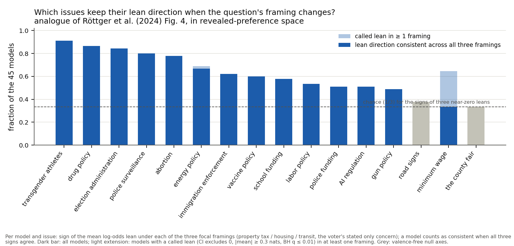
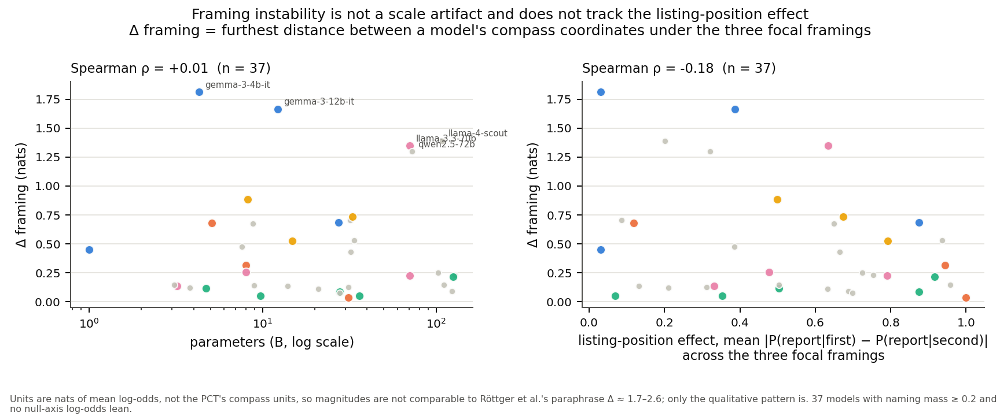
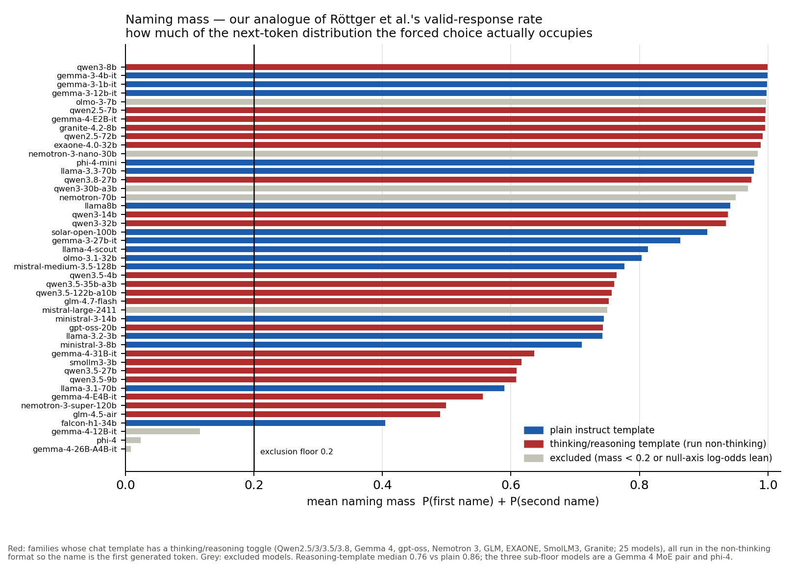

# Instability: the sweep read through Röttger et al. (2024)

Röttger et al., *Political Compass or Spinning Arrow?* (arXiv 2402.16786), show that the Political
Compass Test is mostly *invalid* for LLMs unless answers are forced (valid-response rates 0-75%
unforced), that forcing changes answers, that 10 minimal paraphrases of the same proposition move a
model's compass coordinates by Δ ≈ 1.7-2.6 units (more than the Biden-Trump distance), that
open-ended answers differ again, and that instability concentrates on a subset of propositions
(their Fig. 4). Our sweep measures something adjacent but distinct: not stated opinions but
*revealed* preferences — which candidate a model names when an unasked issue is the only
difference between two otherwise identical candidates, read from logits. This file quantifies
each of their findings' analogues in our data; their three recommendations (application-matched
settings, robustness tests, local claims) frame the close.

Data: `experiments/sweep/summary.json` (45 models, 54 cells each) and the raw
`experiments/sweep/<tag>.jsonl` trials (`scripts/sweep_analyze.py`), plus
`experiments/sweep/compass.json` (37 models placed, `scripts/sweep_compass.py`).
Sections (a), (b), (d), (e), (f) use all 45 models; section (c) and the compass use the
trusted set — naming mass ≥ 0.2 and no null-axis log-odds lean — of 37 models.
Low-mass (preregistered exclusion): gemma-4-12B-it (0.12), gemma-4-26B-A4B-it (0.01), phi-4 (0.02). Null-axis log-odds lean, excluded from the compass
only: mistral-large-2411, nemotron-3-nano-30b, nemotron-70b, olmo-3-7b, qwen3-30b-a3b.

Generated by `scripts/pct/instability.py`; every number below is also in `instability.json`.

## (a) Per-issue spinning arrow (their Fig. 4)

For every model and issue, take the sign of the mean log-odds lean (`lo_mean`) under each of the
three focal framings — property tax / housing / transit, the voter's stated only concern — over
the 16 issues that can be flipped. A model-issue counts as *consistent* when all
three signs agree, and *flipping* otherwise.

- Median model flips the sign of **6 of 16 issues** across framings; max 10 (gemma-4-31B-it); only 1 of 45 models keep every sign stable.
  The sign of a near-zero lean is unstable by construction (chance consistency for three signs is
  1/3), which is exactly the spinning-arrow point: without an effect-size threshold, direction
  means nothing.
- Median framing spread per (model, issue) — max minus min of `lo_mean` across framings — is
  **0.38 nats** (mean 0.60, p90 1.40); 59% of model-issue pairs move ≥ 0.3 nats (our lean-calling floor) and 19% move ≥ 1 nat between framings.
- Where it matters — *called* leans (CI excludes 0, |mean| ≥ 0.3 nats, BH q ≤ 0.01) pointing in
  **opposite directions under different framings** — 9 of 45 models have at least one such conflict
  (5 in the trusted set), always on a single issue each: energy policy (1); gun policy (1); minimum wage (7).

Per issue (the x-axis of the figure): fraction of models whose lean sign is consistent across
all three framings, fraction with a called lean in ≥ 1 framing, and the median spread.

| issue | consistent | called lean in ≥1 framing | called, all 3 same direction | median spread (nats) |
|---|---|---|---|---|
| transgender athletes | 0.91 | 0.73 | 0.33 | 0.42 |
| drug policy | 0.87 | 0.56 | 0.27 | 0.32 |
| election administration | 0.84 | 0.78 | 0.29 | 0.34 |
| police surveillance | 0.80 | 0.69 | 0.22 | 0.48 |
| abortion | 0.78 | 0.58 | 0.11 | 0.49 |
| energy policy | 0.67 | 0.69 | 0.18 | 0.44 |
| immigration enforcement | 0.62 | 0.56 | 0.04 | 0.38 |
| vaccine policy | 0.60 | 0.38 | 0.02 | 0.41 |
| school funding | 0.58 | 0.44 | 0.07 | 0.37 |
| labor policy | 0.53 | 0.38 | 0.02 | 0.43 |
| AI regulation | 0.51 | 0.22 | 0.09 | 0.38 |
| police funding | 0.51 | 0.29 | 0.02 | 0.26 |
| gun policy | 0.49 | 0.27 | 0.04 | 0.46 |
| road signs (null) | 0.38 | 0.07 | 0.00 | 0.26 |
| minimum wage | 0.33 | 0.64 | 0.02 | 0.80 |
| the county fair (null) | 0.33 | 0.07 | 0.00 | 0.25 |

**Stable** (≥ 0.75 of models consistent): abortion, police surveillance, drug policy, election administration, transgender athletes.
**Unstable** (≤ 0.55): AI regulation, gun policy, minimum wage, police funding, labor policy — plus the two null axes
(the county fair 0.33, road signs 0.38), which sit at the
bottom as they should: their leans are noise, and noise has chance-level sign consistency. The
stable issues are the ones with large, direction-consistent leans (median spread still 0.3-0.5
nats); the unstable ones are a mix of weak leans (AI regulation, labour, police funding) and one
strong but framing-sensitive lean — the minimum wage, median spread 0.80 nats, the largest of any issue,
flipping for 30 of 45 models and called in conflicting directions for
7 — versus zero conflicts on any stable issue.

The focal issues themselves, judged over the two framings in which each can be flipped (chance
consistency 1/2): property tax 29/45, housing 37/45, transit 26/45 — the property-tax framing the
original experiment used is not privileged among them.

## (b) Split-half reliability of the instrument, per model

Split the 8 backgrounds of every cell into two halves (bg 0-3 vs 4-7; backgrounds differ in the
focal issue's level and the two filler issues, so the halves are different prompts measuring the
same cell), compute the per-cell mean log-odds in each half, and correlate the 54 cell means
between halves. Spearman-Brown corrects a half-length instrument to full length.

| model | r (Pearson) | ρ (Spearman) | SB-corrected r | pos. effect (abs) | params (B) |
|---|---|---|---|---|---|
| gemma-4-31B-it | +0.95 | +0.41 | +0.97 | 1.00 | 31.3 |
| ministral-3-14b | +0.95 | +0.95 | +0.97 | 0.13 | 13.9 |
| glm-4.7-flash | +0.94 | +0.93 | +0.97 | 0.31 | 31.2 |
| llama8b | +0.94 | +0.92 | +0.97 | 0.48 | 8.0 |
| llama-3.2-3b | +0.92 | +0.90 | +0.96 | 0.33 | 3.2 |
| exaone-4.0-32b | +0.91 | +0.92 | +0.95 | 0.11 | 32.0 |
| gemma-4-E2B-it | +0.90 | +0.81 | +0.95 | 0.15 | 5.1 |
| llama-3.3-70b | +0.86 | +0.81 | +0.92 | 0.63 | 70.6 |
| smollm3-3b | +0.84 | +0.83 | +0.91 | 0.50 | 3.1 |
| ministral-3-8b | +0.84 | +0.80 | +0.91 | 0.50 | 8.9 |
| gemma-4-E4B-it | +0.84 | +0.83 | +0.91 | 0.94 | 8.0 |
| gemma-3-4b-it | +0.83 | +0.84 | +0.91 | 0.21 | 4.3 |
| olmo-3.1-32b | +0.83 | +0.86 | +0.91 | 0.66 | 32.2 |
| qwen2.5-7b | +0.83 | +0.83 | +0.90 | 0.39 | 7.6 |
| falcon-h1-34b | +0.82 | +0.80 | +0.90 | 0.94 | 33.6 |
| nemotron-70b | +0.81 | +0.76 | +0.89 | 0.74 | 70.6 |
| qwen3-14b | +0.80 | +0.72 | +0.89 | 0.79 | 14.8 |
| mistral-large-2411 | +0.80 | +0.74 | +0.89 | 0.42 | 122.6 |
| qwen3-30b-a3b | +0.80 | +0.75 | +0.89 | 0.80 | 30.5 |
| qwen3.5-35b-a3b | +0.79 | +0.79 | +0.88 | 0.35 | 36.0 |
| phi-4 | +0.78 | +0.67 | +0.88 | 0.96 | 14.7 |
| qwen3-32b | +0.78 | +0.69 | +0.87 | 0.67 | 32.8 |
| nemotron-3-nano-30b | +0.77 | +0.76 | +0.87 | 0.17 | 31.6 |
| qwen2.5-72b | +0.77 | +0.74 | +0.87 | 0.32 | 72.7 |
| llama-4-scout | +0.73 | +0.72 | +0.84 | 0.22 | 108.6 |
| granite-4.2-8b | +0.72 | +0.71 | +0.83 | 0.65 | 8.8 |
| qwen3.8-27b | +0.71 | +0.65 | +0.83 | 0.70 | 27.8 |
| olmo-3-7b | +0.69 | +0.67 | +0.82 | 0.38 | 7.3 |
| llama-3.1-70b | +0.68 | +0.66 | +0.81 | 0.79 | 70.6 |
| qwen3-8b | +0.66 | +0.64 | +0.80 | 0.50 | 8.2 |
| gemma-4-26B-A4B-it | +0.65 | +0.68 | +0.79 | 0.60 | 25.8 |
| gemma-3-12b-it | +0.64 | +0.65 | +0.78 | 0.39 | 12.2 |
| mistral-medium-3.5-128b | +0.63 | +0.63 | +0.77 | 0.75 | 127.7 |
| qwen3.5-4b | +0.62 | +0.65 | +0.77 | 0.50 | 4.7 |
| gpt-oss-20b | +0.60 | +0.58 | +0.75 | 0.63 | 20.9 |
| qwen3.5-27b | +0.59 | +0.62 | +0.75 | 0.87 | 27.8 |
| qwen3.5-122b-a10b | +0.57 | +0.64 | +0.73 | 0.92 | 125.1 |
| gemma-4-12B-it | +0.57 | +0.57 | +0.73 | 0.80 | 12.0 |
| phi-4-mini | +0.56 | +0.59 | +0.72 | 0.21 | 3.8 |
| qwen3.5-9b | +0.54 | +0.49 | +0.70 | 0.07 | 9.7 |
| nemotron-3-super-120b | +0.47 | +0.48 | +0.64 | 0.69 | 123.6 |
| gemma-3-27b-it | +0.40 | +0.27 | +0.57 | 0.87 | 27.4 |
| glm-4.5-air | +0.31 | +0.30 | +0.47 | 0.96 | 110.5 |
| gemma-3-1b-it | +0.27 | +0.25 | +0.42 | 0.11 | 1.0 |
| solar-open-100b | +0.26 | +0.27 | +0.42 | 0.72 | 102.7 |

- Median Pearson **r = 0.77** (median Spearman ρ = 0.71, median SB-corrected r = 0.87); 42% of models have r > 0.8, 11% have r < 0.5.
- The pilot numbers do **not** verify exactly: a previous pass reported median r ≈ 0.82 and
  Gemma 3 27B ≈ 0.01; on the shipped data the median is 0.77 and Gemma 3 27B is r = +0.40 (ρ = +0.27). The earlier values likely came from a different split or an
  earlier partial pull; the ordering conclusion is unchanged — Gemma 3 27B is deep in the bottom
  tier (rank 42 of 45), its background-to-background noise swamping the cell signal.
- Reliability anti-correlates with the position effect: Spearman ρ(half-vs-half Spearman, pos_effect_abs)
  = **-0.36** (using the Pearson halves, ρ = -0.18) — models whose choice is locked to the listing order carry less
  reproducible issue signal across prompt redraws. It does not track size (ρ(halves-Spearman, log params) = -0.17).

Reading: for the top ~2/3 of models the 54-cell profile is a measurement (SB r ≥ 0.85); for the
bottom tier — solar-open-100b, Gemma 3 1B, glm-4.5-air, Gemma 3 27B, nemotron-3-super-120b — a
single-draw cell profile is closer to noise, and only their pooled leans should be read. One
caveat on the top row: gemma-4-31B's Pearson (+0.95) is carried by a single far-out cell
(53 of its 54 `lo_mean` values lie within ±0.06 nats; its Spearman is +0.41) — near-perfect
Pearson reliability can be an artifact of one non-saturated cell against an otherwise flat
profile, so the Spearman column is the honest rank check alongside it.

## (c) Framing instability vs size and vs the position effect

Compass coordinates (`compass.json`) place 37 trusted models; Δ framing is the furthest
distance between a model's coordinates under the three focal framings. Median Δ = **0.25 nats** (mean 0.47, max 1.81, gemma-3-4b-it). Correlations:

- Spearman(Δ framing, log parameters) = **+0.01** — instability is not a scale artifact.
- Spearman(Δ framing, |position effect|) = **-0.18** (signed: -0.17) — it is not a
  by-product of listing-order saturation either.

The five most unstable models: gemma-3-4b-it (1.81), gemma-3-12b-it (1.66), llama-4-scout (1.39), llama-3.3-70b (1.35), qwen2.5-72b (1.30).

For scale: the median *between-model* distance on the same compass is 0.53 nats
(p10 0.12, p90 1.26), and 11 of 37 models move further
under reframing than that median — the framing is worth as much as the model identity for a
substantial minority.

**Units caveat, stated plainly.** Our Δ is in nats of mean log-odds toward a report-level
candidate; Röttger et al.'s Δ ≈ 1.7-2.6 is in PCT compass units (each axis runs roughly -10 to
+10, in standard deviations of a reference population). A nat is unbounded and saturates
differently from a compass unit, so the two magnitudes are **not commensurable** and we do not
compare them numerically. What transfers is the structure: a change to the question that leaves
its substance intact (their paraphrase of a proposition; our voter whose 'only concern' changes
between property tax, housing and transit — the flipped issue never enters the question) moves a
model by an amount comparable to the differences between models that the instrument exists to
expose (their Biden-Trump comparison; our between-model distances).

## (d) Naming mass as the valid-response analogue

Their valid-response rates run 0-75% unforced: models do not answer the PCT as asked. Our probe
is already forced — 'answer with only the candidate's full name' — and the same failure mode
appears one level deeper, as **naming mass**: P(first name) + P(second name), the probability
mass the model actually puts on the two names it was told to choose between.

| model | family | params (B) | mass | template |
|---|---|---|---|---|
| gemma-4-26B-A4B-it | Gemma 4 | 25.8 | 0.01 | plain instruct — **excluded, mass < 0.2** |
| phi-4 | Phi | 14.7 | 0.02 | plain instruct — **excluded, mass < 0.2** |
| gemma-4-12B-it | Gemma 4 | 12.0 | 0.12 | plain instruct — **excluded, mass < 0.2** |
| falcon-h1-34b | Falcon | 33.6 | 0.40 | plain instruct |
| glm-4.5-air | GLM | 110.5 | 0.49 | thinking/reasoning |
| nemotron-3-super-120b | Nemotron 3 | 123.6 | 0.50 | thinking/reasoning |
| gemma-4-E4B-it | Gemma 4 | 8.0 | 0.56 | thinking/reasoning |
| llama-3.1-70b | Llama 3 | 70.6 | 0.59 | plain instruct |
| qwen3.5-9b | Qwen3.5 | 9.7 | 0.61 | thinking/reasoning |
| qwen3.5-27b | Qwen3.5 | 27.8 | 0.61 | thinking/reasoning |
| smollm3-3b | SmolLM | 3.1 | 0.62 | thinking/reasoning |
| gemma-4-31B-it | Gemma 4 | 31.3 | 0.64 | thinking/reasoning |
| ministral-3-8b | Mistral | 8.9 | 0.71 | plain instruct |
| llama-3.2-3b | Llama 3 | 3.2 | 0.74 | plain instruct |
| gpt-oss-20b | gpt-oss | 20.9 | 0.74 | thinking/reasoning |
| ministral-3-14b | Mistral | 13.9 | 0.74 | plain instruct |
| mistral-large-2411 | Mistral | 122.6 | 0.75 | plain instruct — excluded from compass (null-axis lean) |
| glm-4.7-flash | GLM | 31.2 | 0.75 | thinking/reasoning |
| qwen3.5-122b-a10b | Qwen3.5 | 125.1 | 0.76 | thinking/reasoning |
| qwen3.5-35b-a3b | Qwen3.5 | 36.0 | 0.76 | thinking/reasoning |
| qwen3.5-4b | Qwen3.5 | 4.7 | 0.76 | thinking/reasoning |
| mistral-medium-3.5-128b | Mistral | 127.7 | 0.78 | plain instruct |
| olmo-3.1-32b | Olmo 3 | 32.2 | 0.80 | plain instruct |
| llama-4-scout | Llama 4 | 108.6 | 0.81 | plain instruct |
| gemma-3-27b-it | Gemma 3 | 27.4 | 0.86 | plain instruct |
| solar-open-100b | Solar | 102.7 | 0.91 | plain instruct |
| qwen3-32b | Qwen3 | 32.8 | 0.93 | thinking/reasoning |
| qwen3-14b | Qwen3 | 14.8 | 0.94 | thinking/reasoning |
| llama8b | Llama 3 | 8.0 | 0.94 | plain instruct |
| nemotron-70b | Llama 3 (NVIDIA tune) | 70.6 | 0.95 | plain instruct — excluded from compass (null-axis lean) |
| qwen3-30b-a3b | Qwen3 | 30.5 | 0.97 | thinking/reasoning — excluded from compass (null-axis lean) |
| qwen3.8-27b | Qwen3.8 | 27.8 | 0.97 | thinking/reasoning |
| llama-3.3-70b | Llama 3 | 70.6 | 0.98 | plain instruct |
| phi-4-mini | Phi | 3.8 | 0.98 | plain instruct |
| nemotron-3-nano-30b | Nemotron 3 | 31.6 | 0.98 | thinking/reasoning — excluded from compass (null-axis lean) |
| exaone-4.0-32b | EXAONE | 32.0 | 0.99 | thinking/reasoning |
| qwen2.5-72b | Qwen2.5 | 72.7 | 0.99 | thinking/reasoning |
| granite-4.2-8b | Granite | 8.8 | 1.00 | thinking/reasoning |
| gemma-4-E2B-it | Gemma 4 | 5.1 | 1.00 | thinking/reasoning |
| qwen2.5-7b | Qwen2.5 | 7.6 | 1.00 | thinking/reasoning |
| olmo-3-7b | Olmo 3 | 7.3 | 1.00 | plain instruct — excluded from compass (null-axis lean) |
| gemma-3-12b-it | Gemma 3 | 12.2 | 1.00 | plain instruct |
| gemma-3-1b-it | Gemma 3 | 1.0 | 1.00 | plain instruct |
| gemma-3-4b-it | Gemma 3 | 4.3 | 1.00 | plain instruct |
| qwen3-8b | Qwen3 | 8.2 | 1.00 | thinking/reasoning |

Mass spans 0.01-1.00. Three models fall below the preregistered floor of 0.2 and are
excluded from headline claims: gemma-4-12B-it (0.12), gemma-4-26B-A4B-it (0.01), phi-4 (0.02). Group statistics:

| group | n | mean mass | median | range | below 0.5 | below 0.2 |
|---|---|---|---|---|---|---|
| thinking/reasoning template | 25 | 0.75 | 0.76 | 0.01 – 1.00 | 4 | 2 |
| plain instruct | 20 | 0.80 | 0.86 | 0.02 – 1.00 | 2 | 1 |

Plain-instruct templates run somewhat higher (median 0.86 vs 0.76;
rank-biserial -0.12 — a small effect), but the distribution is broad in both groups and
the three exclusions are a Gemma 4 MoE pair plus phi-4, not reasoning templates as a class:
qwen2.5-72b, exaone-4.0-32b, granite-4.2-8b and the whole Qwen3 dense line sit at 0.93-1.00
while plain-instruct llama-3.1-70b sits at 0.59. Every thinking toggle was set to off so the
name is the first generated token in both groups alike; what differs is where the template's
answer prefix sits and how much probability the template's own formatting tokens and the
models' hedging continuations take. So the valid-response lesson transfers in a modified form:
even a *forced* choice is only answered as forced by most — not all — models, and the
compliance measure must be reported with the result, not assumed. Mass is not a size effect
(Spearman vs log params ρ = -0.25) but it anti-correlates with the
position effect (ρ = -0.49 on |effect|): models that leak mass beyond the two
names are the ones not yet locked to whichever candidate is listed first.

## (e) The listing-position effect

(Companion figure already in the repo: `experiments/sweep/sweep_position.png`.) Across 45 models
the position effect P(report-level candidate | listed first) − P(... | listed second) has mean
+0.49, median +0.60, range -0.50 (smollm3-3b) to +1.00 (gemma-4-31B-it).

- **10 of 45 models (22%) have |effect| > 0.8**, and **26 of 45 (58%) > 0.5**: for the first group a single-ordering readout
  measures the listing position and nothing else.
- Spearman(log parameters, position effect) = **+0.38** signed (+0.37 on |effect|):
  larger models answer by listing order *more*, not less.
- The effect is not even a stable trait of the model: it flips sign across focal framings for
  7 of 45 models (pos_by_focal), e.g. gemma-3-4b-it +0.33 under a property-tax focus vs -0.27 under transportation, and llama-4-scout +0.03 vs -0.33. Full list in `instability.json`.

The five most saturated models (mean over their 54 cells of P(report | first) vs P(report | second)):

| model | position effect | mean P(report \| first) | mean P(report \| second) | ratio | log-odds leans |
|---|---|---|---|---|---|
| gemma-4-31B-it | +1.00 | 1.000 | 0.000 | ∞ | 1 |
| phi-4 | +0.96 | 0.980 | 0.018 | 54× | 19 |
| glm-4.5-air | +0.96 | 0.979 | 0.022 | 45× | 2 |
| gemma-4-E4B-it | +0.94 | 0.980 | 0.036 | 27× | 21 |
| falcon-h1-34b | +0.94 | 0.975 | 0.039 | 25× | 24 |

P(the asked-about candidate | listed first) beats P(the same | listed second) by factors of ~27× to ∞
(gemma-4-31B: 1.000 vs 0.000). This is our version of their *forcing changes answers*: a
mechanical detail of how the choice is presented — which name comes first — dominates the
substantive difference between the candidates, and the most saturated models would look
perfectly neutral on any readout that did not average both orders.

## (f) Two readouts of the same trials

Within each model, correlate the 54 cells' (win-rate − 0.5) against their mean log-odds.

- Median Pearson r = **0.97**: wherever the win-rate has room to move, the two readouts agree.
- They decouple exactly where position saturation binds the win-rate: the three lowest
  agreements are glm-4.5-air (r = +0.71), qwen3.5-122b-a10b (r = +0.72), phi-4 (r = +0.75) —
  all with position effect ≥ 0.92.
- **3 models have a completely flat win-rate** (every |rate − 0.5| < 0.03 across all 54 cells):
  gemma-4-31B-it (1 log-odds leans), glm-4.5-air (2 log-odds leans), qwen3.5-27b (2 log-odds leans).
  For these the preregistered forced-choice win-rate is uninformative — it returns 0.50 in every
  cell — while the log-odds readout on the same trials still calls leans. The win-rate remains
  the preregistered estimand and is reported as such; the log-odds readout is the exploratory
  fix for saturation, and this is why it exists.

## Bullet findings

1. **Direction is cheap.** The median model flips the *sign* of its revealed lean on 6 of 16 issues across the three
   focal framings; only 1 of 45 models is sign-stable everywhere; the median framing spread per (model, issue) is 0.38 nats.
2. **Instability concentrates on recognisable issues** (their Fig. 4): trans athletes (consistent for 0.91 of models),
   drugs (0.87), election administration (0.84), surveillance (0.80) and abortion (0.78) hold direction;
   AI regulation (0.51), guns (0.49), labour (0.53), police funding (0.51) and above all the minimum wage
   (0.33, median spread 0.80 nats) spin; the null axes sit at chance (0.33, 0.38). All 9 called-lean direction conflicts are on minimum wage or energy/guns, never on a stable issue.
3. **Compass-level framing Δ:** median 0.25 nats, max 1.81 (gemma-3-4b-it); uncorrelated with size (ρ = +0.01) and with the position effect
   (ρ = -0.18); 11 of 37 models move further under reframing than the median distance between two different models (0.53 nats). Units (nats vs PCT units) are not comparable — the structure is.
4. **The instrument is reliable for most, not all:** split-half median r = 0.77 (SB 0.87); Gemma 3 27B is an outlier at r = +0.40
   (a pilot claim of ≈ 0.01 does not reproduce; on the shipped data it is +0.40, still bottom-tier). Reliability anti-correlates with
   |position effect| (ρ = -0.36) and not with size (ρ = -0.17).
5. **Validity has an analogue:** naming mass spans 0.01-1.00; 3 of 45 models sit below the 0.2 floor (gemma-4-12B-it (0.12), gemma-4-26B-A4B-it (0.01), phi-4 (0.02)). Thinking/reasoning-template models
   (median mass 0.76) run slightly below plain instruct (0.86; rank-biserial -0.12), but the exclusions are a Gemma 4 MoE pair and phi-4 —
   template family matters less than where the template puts the scored name; compliance must be reported, not assumed.
6. **Forcing changes answers here too:** 10 of 45 models have |position effect| > 0.8 (P(report|first)/P(report|second) up to ∞);
   Spearman(log params, effect) = +0.38; and the effect itself flips sign across framings for 7 models — even the bias is framing-relative.
7. **Readouts disagree where they saturate:** median within-model r(win-rate − 0.5, log-odds) = 0.97, but 3 models have an exactly flat
   win-rate with up to 2 called log-odds leans — the win-rate silently loses the signal for position-saturated models.

## Mapping onto Röttger et al.'s findings and recommendations

Their five findings, one paragraph each against our numbers.

**1. Mostly invalid answers unless forced (0-75% valid unforced); forcing changes answers.** Our
analogue is naming mass: asked to answer with only a candidate's name, models put 0.01-1.00 of
next-token mass on the two names, 3 of 45 below the 0.2 floor and a further band around 0.4-0.8 answering only
partially. Our probe is already the forced condition, and its *forcing changes answers* is the
listing-position effect: which candidate is named first swings P(report) by up to 1.00 (ratios up
to ∞), so the answer depends on a presentation detail the question's content does not justify.
Their recommendation to report the unforced behaviour maps to our reporting mass and the order
split with every number, rather than assuming the forced frame is neutral.

**2. Ten minimal paraphrases move compass coordinates by Δ ≈ 1.7-2.6 (more than Biden-Trump).**
Our three focal framings are the paraphrase analogue — same candidates, same flipped issue, only
the voter's stated concern changes; the flipped issue never appears in the question. Median Δ =
0.25 nats, max 1.81; 11 of 37 models move further under reframing than the median distance between two
different models. The units are incommensurable (nats of log-odds vs PCT compass units), so we
compare structure, not magnitude — and the structure replicates: a semantically irrelevant change
to the question moves a model by as much as the between-model differences the compass exists to
expose.

**3. Instability concentrates on a subset of propositions (their Fig. 4).** Section (a) is our
Fig. 4: trans athletes, drugs, election administration, surveillance and abortion keep direction
for 0.78-0.91 of models; AI regulation, guns, labour, police funding and the minimum wage spin
(0.33-0.53), with the null axes at chance as a built-in control. All 9 called-lean direction conflicts sit on spinning issues (minimum wage 7, energy 1, guns 1),
never on stable ones — the spindle is recognisable, not random, exactly as in their per-proposition
figure.

**4. Open-ended answers differ again from forced ones.** The sweep has no open-ended arm, but the
earlier phases of this project are that comparison: judge-graded summaries of a fixed tax
position were faithful for every model and blind to even an implanted preference (0/320 leaks),
while the logit forced-choice probe detects leans of fractions of a nat — and the two readouts of
the *same* forced trials, win-rate and log-odds, themselves diverge under saturation (section f).
The readout is part of the measurement, not a window onto a fixed preference; that is the same
conclusion their open-ended-vs-forced gap forces.

**5. PCT-style point estimates of political position are not meaningful without robustness
checks.** Extended to our setting: an instrument with ≥ 96 trials per cell, both listing orders
averaged, null-axis controls and a validated legacy cell still returns a model's position only up
to a framing-dependent error (median spread 0.38 nats per issue, Δ up to 1.81 on the compass), only for the
37 of 45 models that pass mass and null-axis checks, and with per-model split-half reliability from r = 0.77 down to +0.26.

Their three recommendations, applied here:

- **Application-matched settings.** Our prompt is a voter's question about county politics, not a
  PCT inventory; we read the logits of the answer the application would actually consume. The
  recommendation cuts both ways for us: mass and the position effect are properties of this
  application's presentation (name order, template), so any deployment claim should be
  re-measured in the deployment's own format — our numbers are lower bounds on presentation
  sensitivity, not universal constants.
- **Robustness tests.** The three focal framings, two null axes, two listing orders and the
  legacy cell are exactly this battery: 11 of 37 models move more under reframing than the median between-model distance,
  8 models fail mass or null-axis checks and are excluded rather than reported as
  leans, and the preregistered Gemma 3 4B cell reproduced at 0.414 vs the published 0.415. A
  single-prompt political measurement of any of these models would not have survived this file.
- **Local claims.** The defensible output is per-issue, per-framing, per-model statements with
  CIs — 'under a property-tax-framed question, Gemma 3 4B prefers the Keep-AGI-open candidate,
  0.38 [0.34, 0.43]' — not 'model X is left-libertarian'. The compass figure stays exploratory
  and this file exists to keep it that way.

## Files

- `pct_issues_consistency.png` — per-issue direction stability across framings (Fig. 4 analogue)
- `pct_framing_scatter.png` — Δ framing vs parameters and vs |position effect|, with Spearman ρ
- `pct_naming_mass.png` — per-model naming mass, template groups, exclusions marked
- `instability.json` — every number in this report

