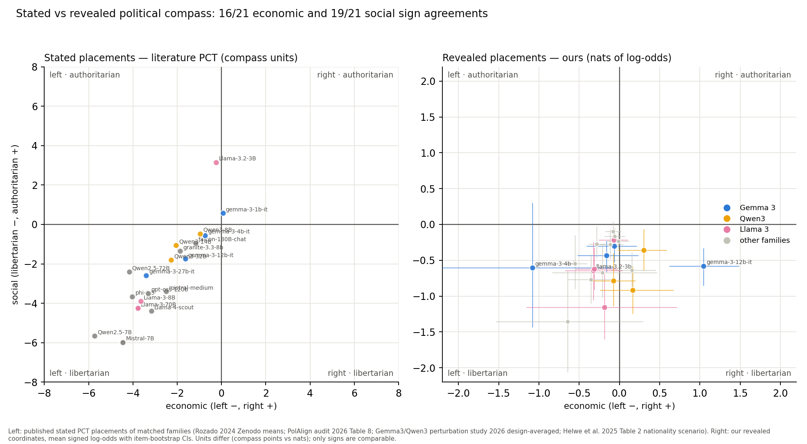

# Our revealed compass vs the literature's stated PCT placements

Two different quantities. The literature column is a model's **stated** position: the Political Compass
Test administered as (forced) multiple choice over 62 propositions, scored by the PCT's own algorithm into
compass units. Our column is a **revealed** position: which candidate the model picks, read from logits, when
an unasked political issue differs between two otherwise identical candidates; the coordinate is the mean
signed log-odds over that axis's county-level issues, in nats. Only the signs are directly comparable.

Matching rule: exact checkpoint first, then nearest parameter count within the nearest tested generation of
the same family (see the MATCH table in `scripts/pct/literature_compare.py`); family-level entries serve
several of our checkpoints. GLM, EXAONE, OLMo, Nemotron, SmolLM, Solar, Qwen 3.5/3.8, Gemma 4, Ministral 3
and Phi 4 have no published stated-PCT coordinates we could find (2024-2026) and are excluded.

## (a) Side-by-side coordinates

| our model | family | our economic (nats) | our social (nats) | literature model | stated economic | stated social | source (method) |
|---|---|---|---|---|---|---|---|
| falcon-h1-34b | Falcon | -0.55 [-0.70,-0.40] | -0.54 [-0.90,-0.15] | falcon-180B-chat | -1.17 | -0.95 | [Rozado 2024 (tabulated_results.csv) 2024](https://zenodo.org/records/10553530) (forced MC) |
| gemma-3-12b-it | Gemma 3 | +1.04 [+0.62,+1.49] | -0.58 [-0.85,-0.33] | gemma-3-12b-it | -1.64 | -1.75 | [Gemma3/Qwen3 perturbation study (config CSV) 2026](https://arxiv.org/abs/2609.08637) (logit-read MC, design-averaged) |
| gemma-3-1b-it | Gemma 3 | -0.16 [-0.52,+0.23] | -0.43 [-0.66,-0.23] | gemma-3-1b-it | +0.06 | +0.57 | [Gemma3/Qwen3 perturbation study (config CSV) 2026](https://arxiv.org/abs/2609.08637) (logit-read MC, design-averaged) |
| gemma-3-27b-it | Gemma 3 | -0.07 [-0.41,+0.22] | -0.30 [-0.53,-0.09] | gemma-3-27b-it | -3.41 | -2.59 | [Gemma3/Qwen3 perturbation study (arXiv 2609.08637; config CSV, all 14 languages x 3 quantisations, base condition) 2026](https://arxiv.org/abs/2609.08637) (logit-read MC (softmax over 4 options, 4-way option permutation), design-averaged) |
| gemma-3-4b-it | Gemma 3 | -1.08 [-2.35,-0.06] | -0.60 [-1.44,+0.30] | gemma-3-4b-it | -0.75 | -0.56 | [Gemma3/Qwen3 perturbation study (config CSV) 2026](https://arxiv.org/abs/2609.08637) (logit-read MC, design-averaged) |
| granite-4.2-8b | Granite | +0.15 [-0.11,+0.45] | -0.64 [-0.87,-0.39] | granite-3.3-8b | -1.86 | -1.36 | [PolAlign audit (Table 8) 2026](https://arxiv.org/abs/2601.06194) (forced MC (JSON)) |
| llama-3.1-70b | Llama 3 | -0.07 [-0.26,+0.10] | -0.22 [-0.35,-0.08] | Llama-3-70B | -3.78 | -4.25 | [PolAlign audit (arXiv 2601.06194, Table 8) 2026](https://arxiv.org/abs/2601.06194) (forced MC (JSON)) |
| llama-3.2-3b | Llama 3 | -0.32 [-0.68,+0.04] | -0.64 [-1.06,-0.24] | Llama-3.2-3B | -0.25 | +3.15 | [Helwe et al. 2025, Table 2 2025](https://aclanthology.org/2025.findings-acl.883/) (MC with retries) |
| llama-3.3-70b | Llama 3 | -0.19 [-1.16,+0.71] | -1.16 [-1.60,-0.69] | Llama-3-70B | -3.78 | -4.25 | [PolAlign audit (arXiv 2601.06194, Table 8) 2026](https://arxiv.org/abs/2601.06194) (forced MC (JSON)) |
| llama8b | Llama 3 | -0.31 [-0.55,-0.02] | -0.62 [-0.91,-0.33] | Llama-3-8B | -3.65 | -3.90 | [PolAlign audit (arXiv 2601.06194, Table 8) 2026](https://arxiv.org/abs/2601.06194) (forced MC (JSON single answer, 4 options, 10 runs)) |
| llama-4-scout | Llama 4 | -0.64 [-1.53,+0.29] | -1.35 [-2.06,-0.65] | Llama-4-scout | -3.17 | -4.40 | [PolAlign audit (Table 8) 2026](https://arxiv.org/abs/2601.06194) (forced MC (JSON)) |
| ministral-3-14b | Mistral | -0.28 [-0.39,-0.17] | -0.27 [-0.47,-0.03] | Mistral-7B | -4.45 | -5.99 | [Helwe et al. 2025, Table 2 2025](https://aclanthology.org/2025.findings-acl.883/) (MC with retries) |
| ministral-3-8b | Mistral | -0.02 [-0.15,+0.12] | -0.23 [-0.34,-0.11] | Mistral-7B | -4.45 | -5.99 | [Helwe et al. 2025, Table 2 2025](https://aclanthology.org/2025.findings-acl.883/) (MC with retries) |
| mistral-medium-3.5-128b | Mistral | -0.11 [-0.29,+0.05] | -0.28 [-0.48,-0.07] | mistral-medium | -2.50 | -3.40 | [PolAlign audit (Table 8; Table 16) 2026](https://arxiv.org/abs/2601.06194) (forced MC (JSON)) |
| phi-4-mini | Phi | -0.08 [-0.18,+0.02] | -0.09 [-0.23,+0.04] | phi-3.5 | -4.03 | -3.67 | [PolAlign audit (Table 8) 2026](https://arxiv.org/abs/2601.06194) (forced MC (JSON)) |
| qwen2.5-72b | Qwen2.5 | -0.36 [-0.64,-0.07] | -0.77 [-1.10,-0.42] | Qwen2.5-72B | -4.17 | -2.41 | [Helwe et al. 2025, Table 2 2025](https://aclanthology.org/2025.findings-acl.883/) (MC with retries) |
| qwen2.5-7b | Qwen2.5 | -0.21 [-0.84,+0.46] | -0.67 [-1.02,-0.28] | Qwen2.5-7B | -5.73 | -5.65 | [Helwe et al. 2025, Table 2 2025](https://aclanthology.org/2025.findings-acl.883/) (MC with retries) |
| qwen3-14b | Qwen3 | -0.08 [-0.38,+0.20] | -0.79 [-1.14,-0.40] | Qwen3-14B | -2.05 | -1.06 | [Gemma3/Qwen3 perturbation study (config CSV) 2026](https://arxiv.org/abs/2609.08637) (logit-read MC, design-averaged) |
| qwen3-32b | Qwen3 | +0.30 [-0.02,+0.59] | -0.36 [-0.64,-0.06] | Qwen3-32B | -2.28 | -1.80 | [Gemma3/Qwen3 perturbation study (config CSV) 2026](https://arxiv.org/abs/2609.08637) (logit-read MC, design-averaged) |
| qwen3-8b | Qwen3 | +0.17 [-0.24,+0.67] | -0.92 [-1.25,-0.59] | Qwen3-8B | -0.96 | -0.47 | [Gemma3/Qwen3 perturbation study (config CSV) 2026](https://arxiv.org/abs/2609.08637) (logit-read MC, design-averaged) |
| gpt-oss-20b | gpt-oss | -0.06 [-0.19,+0.07] | -0.16 [-0.29,-0.04] | gpt-oss-120b | -3.30 | -3.49 | [PolAlign audit (Table 8) 2026](https://arxiv.org/abs/2601.06194) (forced MC (JSON)) |

21 matched model-checkpoints across 10 families (19 distinct literature placements).

## (b) Sign agreement

- Economic (both left / both right): **16/21** matches agree on the sign.
- Social (both libertarian / both authoritarian): **19/21** matches agree on the sign.
- All four signs agree and both land left-libertarian: **15/21**.
  - disagreement: gemma-3-12b-it — ours (+1.04, -0.58) nats vs stated (-1.64, -1.75) compass units [gemma-3-12b-it, Gemma3/Qwen3 perturbation study (config CSV)].
  - disagreement: gemma-3-1b-it — ours (-0.16, -0.43) nats vs stated (+0.06, +0.57) compass units [gemma-3-1b-it, Gemma3/Qwen3 perturbation study (config CSV)].
  - disagreement: granite-4.2-8b — ours (+0.15, -0.64) nats vs stated (-1.86, -1.36) compass units [granite-3.3-8b, PolAlign audit (Table 8)].
  - disagreement: llama-3.2-3b — ours (-0.32, -0.64) nats vs stated (-0.25, +3.15) compass units [Llama-3.2-3B, Helwe et al. 2025, Table 2].
  - disagreement: qwen3-32b — ours (+0.30, -0.36) nats vs stated (-2.28, -1.80) compass units [Qwen3-32B, Gemma3/Qwen3 perturbation study (config CSV)].
  - disagreement: qwen3-8b — ours (+0.17, -0.92) nats vs stated (-0.96, -0.47) compass units [Qwen3-8B, Gemma3/Qwen3 perturbation study (config CSV)].

## (c) Figure

## (d) Discussion

**What agrees.** Every matched literature placement without exception sits in the left-libertarian quadrant,
and our revealed compass agrees on the social axis in 19/21 checkpoints: all 37 of our trustworthy models are socially libertarian (30 with CI excluding zero), and the literature's 
open models are stated there too. The economic axis agrees on most checkpoints (16/21): 32 of our 37 models reveal a left lean. The uniform left-libertarian picture the 
PCT literature reports for GPT-3.5-class and 2024-2026 open models (Rozado's 24-model means (-3.69, -4.19); Röttger's Mistral/GPT-3.5 always libertarian-left across paraphrases) is qualitatively 
reproduced by revealed preferences, which is non-trivial: our instrument never asks for an opinion at all.

**What disagrees.** The exceptions are informative. Gemma 3 12B — economically right of centre in our
revealed coordinates (+1.04 [+0.62,+1.49] nats, the only CI-right model of the 37) — is stated at
(-1.64, -1.75) compass units by the perturbation study, i.e. mildly left-libertarian. Its economic right
lean is driven by per-issue values that all point the same way (property tax +1.87, minimum wage +1.62,
unions +1.14 nats toward the right/report level), so the sign flip is not one outlier item. Helwe et al.'s
Llama-3.2-3B is the literature's single authoritarian placement ((-0.25, +3.15) under nationality
prompting, flipping to L-L under language prompting) and our llama-3.2-3b is mildly libertarian
(-0.64 [-1.06,-0.24]) — itself a marker of how unstable these placements are across elicitation.

**Where the revealed compass adds structure the stated PCT cannot see.** Our per-issue decomposition
shows the left lean is not uniform: the property-tax item leans right for 27 of 37 models and the
vaccine-mandate item leans authoritarian for 13 of 37 (strongest: gemma-3-4b-it +1.57 nats), even though
both items' axis means stay left/libertarian. A stated-opinion instrument averages over 62 abstract
propositions; our county-level framing exposes that 'left-libertarian' models still carry right- and
authoritarian-direction leans on specific instruments of government action. That is exactly the
granularity Röttger et al. warn is lost when a model is compressed to one point, and the framing Δ we
report (median 0.25 nats, max 1.81 for gemma-3-4b-it) is the revealed-preference analogue of their
paraphrase instability (their Mistral moves from (-3.6,-5.2) to (-6.0,-3.5) across paraphrases).

**What cannot be compared. Explicitly:**

1. *Units.* Literature coordinates are PCT compass points; ours are nats of mean log-odds. Magnitudes,
   distances and 'how much more left' are meaningless across the two; only signs are compared here.
2. *Items.* The PCT's 62 abstract national propositions ("If economic globalisation is inevitable...") vs
   our 15 county-level policy instruments (property-tax rates, prevailing wage, deputy staffing). A model
   can coherently state left on globalisation propositions and reveal right on a county property tax.
3. *Elicitation.* Stated: the model is asked its opinion, forced into 4 options, refusals retried or
   forced. Revealed: the model is never asked; we read a name choice from logits, both listings orders
   averaged.
4. *Populations of models.* The literature's placements are for earlier checkpoints (Llama 2, Mixtral,
   Gemma 2, Qwen 1.5/2.5-era, phi-3.5, granite-3.3) or bigger siblings (qwen3-235b, gpt-oss-120b);
   GLM, EXAONE, OLMo, Nemotron, SmolLM, Solar, Qwen 3.5/3.8, Gemma 4, Ministral 3 and Phi 4 have no
   published stated-PCT coordinates we could find, so 17 of our 37 models have no counterpart here.

## Refusal / valid-answer rates vs our naming mass

Röttger et al.'s Fig. 2 (unforced, % valid answers): Zephyr-7b-beta 0.0%; GPT-4 (0613/1106) 0.0%; GPT-3.5-1106 0.2%; Llama-2-7b-chat 6.5%; Llama-2-13b-chat 45.2%; Mistral-7B-Instruct-v0.1 75.8%; Mistral-7B-Instruct-v0.2 71.0%.
Rozado's invalid-answer rates (forced-with-retries): mean 11% across 24 conversational LLMs, openhermes-2.5-mistral-7b <1% invalid, gpt-4 33%, claude-instant 31%.

Our analogue is naming mass — P(first name) + P(second name) on the forced-choice prompt (floor 0.2):

| our model (family) | naming mass | literature relative | valid-answer rate |
|---|---|---|---|
| llama8b | 0.94 | Llama-2-7b-chat (Röttger) | 6.5% unforced; complies with forcing 2-3 |
| llama-3.3-70b | 0.98 | Llama-2-13b/70b-chat (Röttger) | 45.2% / higher unforced |
| mistral-medium-3.5-128b | 0.78 | Mistral-7B-Iv0.1 (Röttger) | 75.8% unforced, 100% forced |
| ministral-3-8b | 0.71 | Mistral-7B-Iv0.1 (Röttger) | 75.8% unforced, 100% forced |
| qwen2.5-7b | 1.00 | qwen-14b-chat / Qwen2.5-7B (Rozado/Helwe) | forced with retries; Rozado mean invalid 11% |
| gemma-3-27b-it | 0.86 | gemma-3-27b (PolAlign 2026) | forced JSON; deterministic over 10 runs |
| gpt-oss-20b | 0.74 | gpt-oss-120b (PolAlign 2026) | forced JSON; sd 0.36/0.38 compass units |
| granite-4.2-8b | 1.00 | granite-3.3-8b (PolAlign 2026) | forced JSON; sd 0.40/0.08 |

The comparison runs the same way in both instruments: the logit-read forced choice is *also* not honoured
uniformly. Our masses run 0.01-1.00 (median 0.76): the three exclusions (gemma-4-26B-A4B 0.01, phi-4
0.02, gemma-4-12B 0.12) are models whose next-token mass lands on neither candidate name — the same
failure mode as Röttger's 0%-valid Zephyr/GPT-4, visible here without any forcing prompt at all.
Conversely the families Röttger found most compliant unforced (Mistral 75.8%) have mid-to-high mass
here (mistral-medium-3.5 0.78, ministral-3-8b 0.71), and Llama — 6.5% valid unforced in 2024 — reads
0.94 on naming mass in 2026 checkpoints, i.e. compliance has improved generation-over-generation while
the left-libertarian stated placement and the left-libertarian revealed lean both persist.

## Sources

- Röttger et al. 2024, *Political Compass or Spinning Arrow?* — https://arxiv.org/abs/2402.16786 (coordinates, valid-answer rates)
- Rozado 2024, *The political preferences of LLMs* — https://arxiv.org/abs/2402.01789 ; per-model means: https://zenodo.org/records/10553530 (tabulated_results.csv); PLOS ONE https://doi.org/10.1371/journal.pone.0306621
- PolAlign audit 2026 — https://arxiv.org/abs/2601.06194 (Table 8 / Table 16)
- Gemma3/Qwen3 perturbation study 2026 — https://arxiv.org/abs/2609.08637 ; configuration-level data: https://github.com/nishan-chatterjee/llm-bias-detection (tasks/political-compass/analysis/data/pct_configuration_scores.csv)
- Helwe et al. 2025, *Navigating the Political Compass* — https://aclanthology.org/2025.findings-acl.883/ (Table 2)
- Bernardelle et al. 2025 — https://arxiv.org/abs/2508.16013 (quadrant-only baselines)
